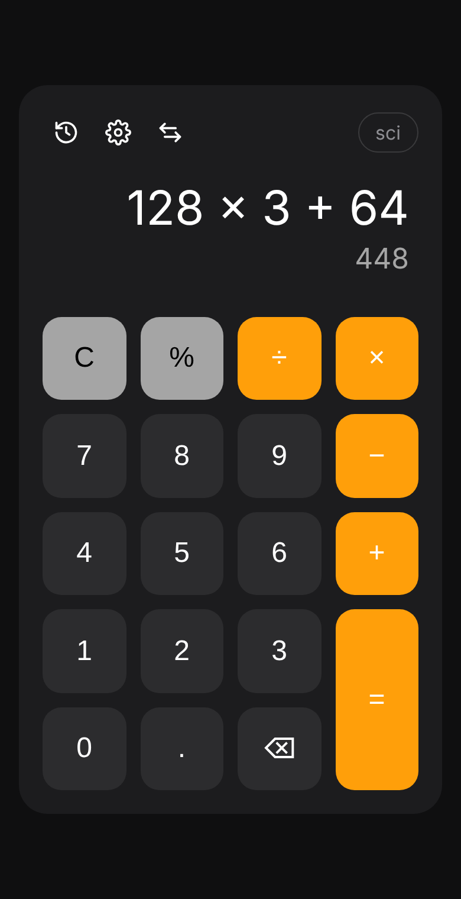
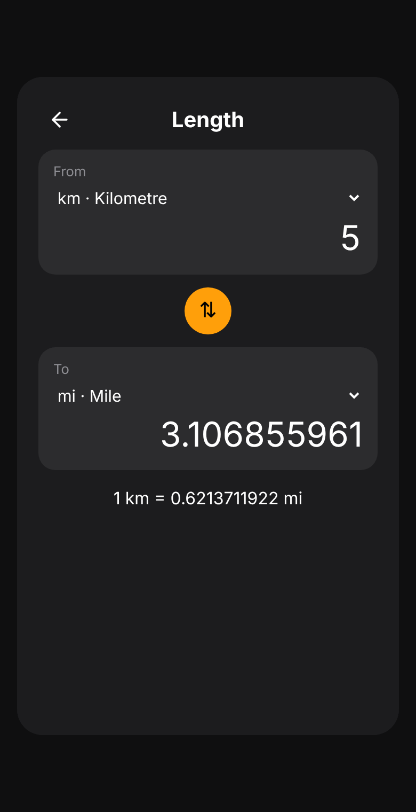
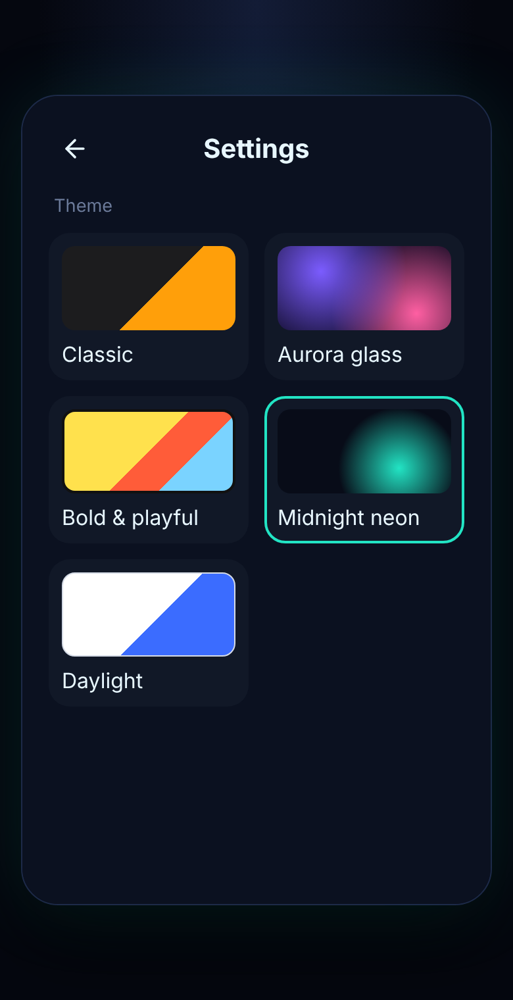
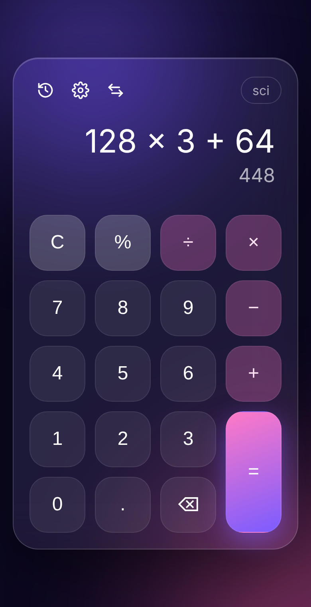
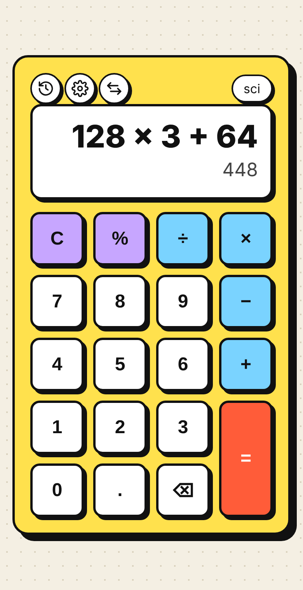
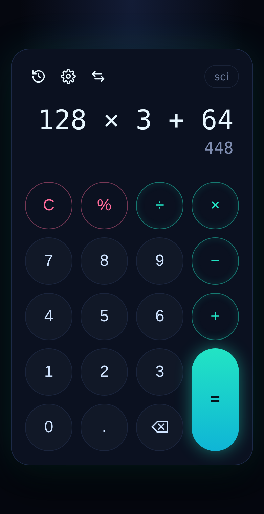

# Calculator

A phone-style calculator for the web, built with React and Vite. It looks and feels like the calculator on your phone, and it goes further: a full scientific mode, a history of past sums, five themes, and 14 converters for currency, units, loans, dates, discounts, number bases and BMI.

It runs entirely in the browser. There are no accounts, no tracking and no server of its own: your history, theme and last-used currencies are saved on your device with `localStorage`. The only network request is for exchange rates.

**Live:** https://calculator-app-psi-one-31.vercel.app

## Screenshots

<table>
  <tr>
    <td align="center"><br>Basic</td>
    <td align="center"><br>Scientific</td>
    <td align="center"><br>History</td>
  </tr>
  <tr>
    <td align="center"><br>Converters</td>
    <td align="center"><br>Length</td>
    <td align="center"><br>Finance</td>
  </tr>
</table>

### The five themes

<table>
  <tr>
    <td align="center"><br>Settings</td>
    <td align="center"><br>Aurora glass</td>
    <td align="center"><br>Bold &amp; playful</td>
    <td align="center"><br>Midnight neon</td>
    <td align="center"><br>Daylight</td>
  </tr>
</table>

## Features

### Calculator

- **Basic keypad** laid out like a phone calculator: clear, percent, delete (⌫) and the four operations. The whole sum stays on screen as you type (for example `128 × 3 + 64`), with the answer underneath.
- **Correct order of operations.** `1 + 2 × 3` is 7, not 9. Sums are read by a hand-written *recursive descent parser*, not JavaScript's `eval`, so only valid maths is ever run.
- **Scientific mode** (the `sci` button, remembered between visits):
  - brackets, powers (xʸ), squares (x²), square roots (√x), reciprocals (1/x) and factorials (x!)
  - sin, cos and tan in degrees or radians, plus their inverses through the `2nd` key
  - log base 10 (lg), natural log (ln), 10ˣ and eˣ
  - the constants π and e, with implied multiplication (`2π` means 2 × π)
- **Careful edge cases.** sin(180°) gives exactly 0 instead of a tiny rounding error, tan(90°) and division by zero show *Error* instead of a huge number, and factorials stop at 170! (the largest JavaScript can hold).
- **Percent that works the way people expect.** `200 + 10%` is 220, and the % stays visible in the sum.
- **Keyboard support:** digits, `+ - * / ^`, `( )`, `%`, `!`, `Enter` or `=` to work it out, `Backspace` to delete and `Esc` to clear.

### History

- Every finished sum is saved, newest first and grouped by day.
- Tap an entry to put its answer back into the calculator and keep going.
- Keeps the latest 100 sums, and a bin button clears them all (after asking first).

### Themes

Five complete looks, picked in **Settings** (the gear icon) and remembered between visits:

| Theme | Style |
| :--- | :--- |
| Classic | Dark, with orange operator keys, like a phone calculator |
| Aurora glass | Frosted-glass keys over a purple and pink glow |
| Bold & playful | Chunky yellow body, pastel keys and thick outlines |
| Midnight neon | Dark navy with glowing teal and pink outlines |
| Daylight | Clean and light, with blue accents |

Each theme is pure CSS: switching changes one attribute (`<html data-theme="neon">`), and the stylesheet does the rest.

### 14 converters

Open them with the arrows icon. The currency and unit converters have a swap button and show the rate they used.

| Converter | What it does |
| :--- | :--- |
| **Currency** | Live exchange rates for every currency the rate sources list, shown with their full names. Uses two free sources (the second is a backup if the first is down), refreshes at most once an hour, and falls back to the last saved rates when you are offline. |
| **Length** | Kilometres to nanometres, miles, yards, feet, inches, nautical miles, astronomical units and light-years |
| **Mass** | Tonnes to micrograms, pounds, ounces, stone, carats, US and UK tons, plus the kati and the Chinese jin |
| **Area** | Square kilometres, hectares, ares, square metres, square miles, acres, square feet and more |
| **Time** | Centuries down to nanoseconds |
| **Data** | Bits and bytes in both systems: KB/MB/GB (1000) and KiB/MiB/GiB (1024), plus kilobits to gigabits |
| **Volume** | Cubic metres, litres, millilitres, and US and UK gallons, pints, cups, fluid ounces and spoons |
| **Speed** | m/s, km/h, mph, knots, feet per second, Mach and the speed of light |
| **Temperature** | Celsius, Fahrenheit, Kelvin and Rankine |
| **Finance** | Loan repayments three ways: equal monthly payment, equal principal (payments shrink each month), or flat rate (common for car loans). Shows the monthly payment, total interest and total repaid. |
| **Date** | Days between two dates (also shown as years, months and days), or a date plus or minus a number of days. Handles leap years and month ends correctly. |
| **Discount** | The final price and your saving, including stacked discounts (20% off plus an extra 10% off is 28% off, not 30%) |
| **Numeral system** | The same whole number in binary, octal, decimal and hexadecimal, with no size limit (uses `BigInt`) |
| **BMI** | Your body mass index, with either international (WHO) or Asian categories, and the healthy weight range for your height |

### Built to be safe and sturdy

- Anything read from storage or from the internet is checked before it's used, so a broken or edited value can't crash the page.
- A slow exchange-rate server is given up on after 8 seconds instead of freezing the app.
- The maths and converter logic (`src/core/`) has no React in it, so the planned mobile app can reuse it as-is.

## Tech

- JavaScript and React 19 (JSX)
- Vite for the dev server and build
- Plain CSS, with themes switched through `<html data-theme>`
- Hosted on Vercel; every push to `main` deploys

## Project layout

```
src/
  core/         Pure logic (maths, converters, storage). No React, so a future React Native app can reuse it.
  components/   React screens: keypad, display, history, settings, converters
  App.jsx       Holds the app state and wires the screens together
  style.css     Layout and the default look
  themes.css    The five themes
```

## Run it locally

You need Node 22 or newer.

```bash
npm install
npm run dev      # start a local server with live reload
npm run build    # make the production build in dist/
```

## Roadmap

- Automated tests in the repo
- A mobile app with React Native, reusing `src/core/`
