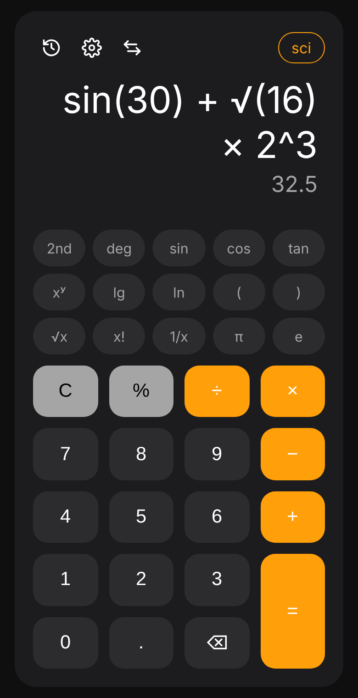
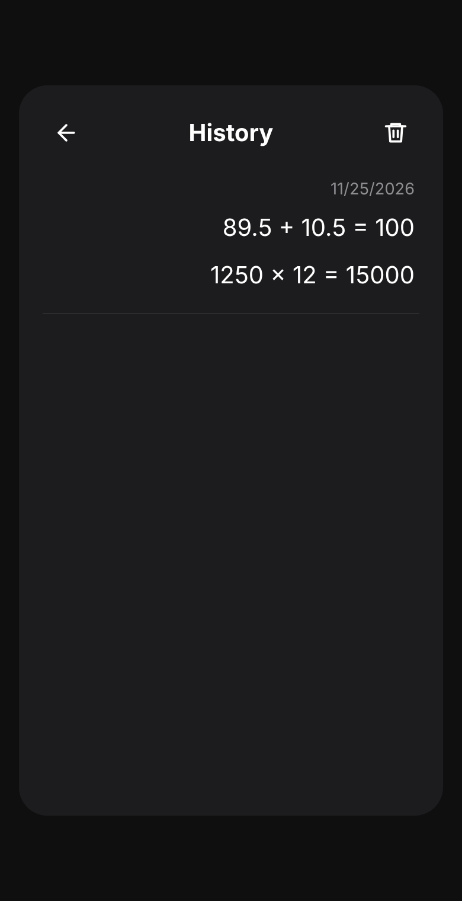
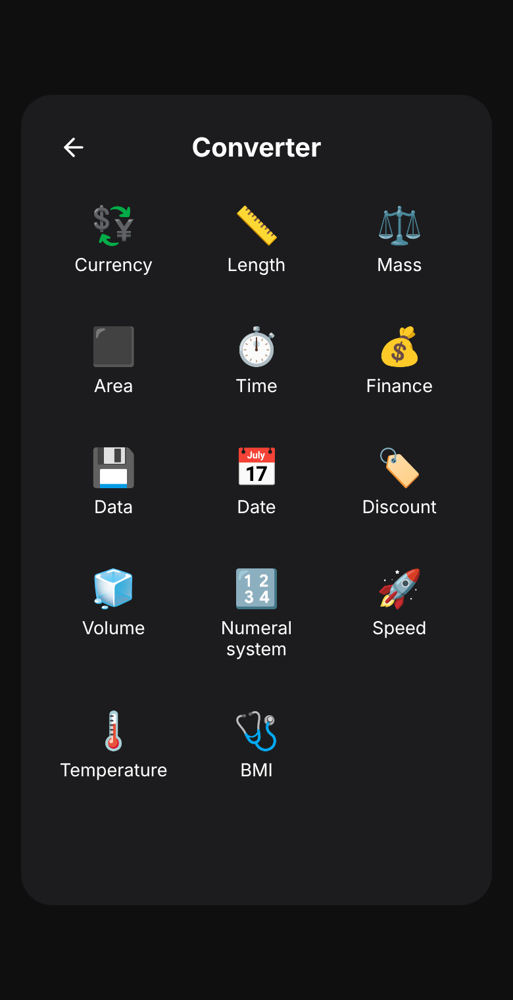
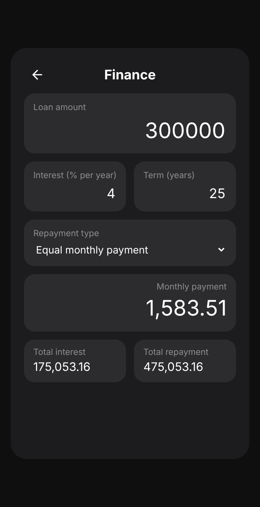
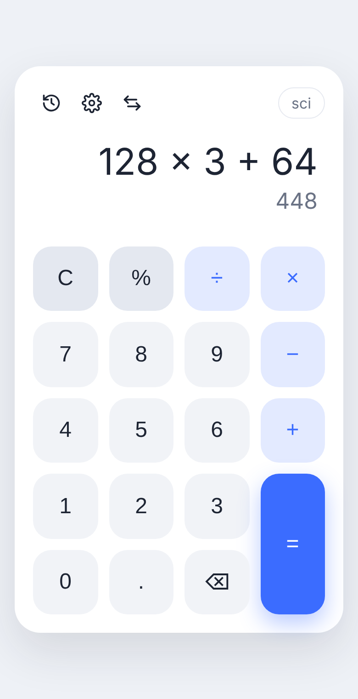

# Calculator

A phone-style calculator for the web, built with React and Vite. It does everyday sums and scientific maths, and it has 14 converters.

**Live:** https://calculator-app-psi-one-31.vercel.app

## Screenshots

<table>
  <tr>
    <td align="center"><br>Basic</td>
    <td align="center"><br>Scientific</td>
    <td align="center"><br>History</td>
  </tr>
  <tr>
    <td align="center"><br>Converters</td>
    <td align="center"><br>Length</td>
    <td align="center"><br>Finance</td>
  </tr>
</table>

### Themes

<table>
  <tr>
    <td align="center"><br>Settings</td>
    <td align="center"><br>Aurora glass</td>
    <td align="center"><br>Bold &amp; playful</td>
    <td align="center"><br>Midnight neon</td>
    <td align="center"><br>Daylight</td>
  </tr>
</table>

## Features

- **Calculator:** a basic keypad, plus a scientific mode with brackets, trig (degrees or radians), logs, powers, roots, factorials, π and e. Works with the keyboard too.
- **History:** past sums grouped by day. Tap one to reuse its answer.
- **Themes:** five styles (Classic, Aurora glass, Bold & playful, Midnight neon, Daylight). Your choice is remembered.
- **Converters:**
  - **Live rates:** currency, from free daily-rate APIs, with a backup source and offline fallback.
  - **Units:** length, mass, area, time, data, volume, speed and temperature.
  - **Everyday tools:**
    - Finance: loan repayments, as equal payment, equal principal or flat rate.
    - Date: days between two dates, or adding and subtracting days.
    - Discount: stacked discounts.
    - Numeral system: binary, octal, decimal and hex.
    - BMI: WHO or Asian categories.

Everything is saved in your browser (`localStorage`). There are no accounts and no server.

## Tech

- JavaScript and React 19 (JSX)
- Vite for the dev server and build
- Plain CSS, with themes switched through `<html data-theme>`
- Hosted on Vercel; every push to `main` deploys

## Project layout

```
src/
  core/         Pure logic (maths, converters, storage). No React, so a future React Native app can reuse it.
  components/   React screens: keypad, display, history, settings, converters
  App.jsx       Holds the app state and wires the screens together
  style.css     Layout and the default look
  themes.css    The five themes
```

## Run it locally

You need Node 22 or newer.

```bash
npm install
npm run dev      # start a local server with live reload
npm run build    # make the production build in dist/
```

## Roadmap

- Automated tests in the repo
- A mobile app with React Native, reusing `src/core/`
